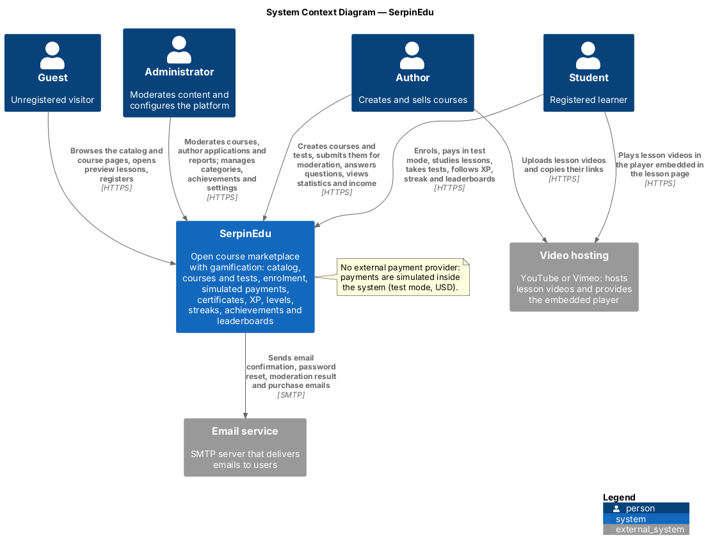
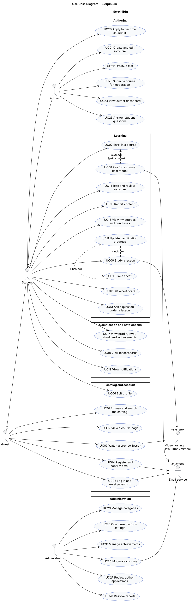
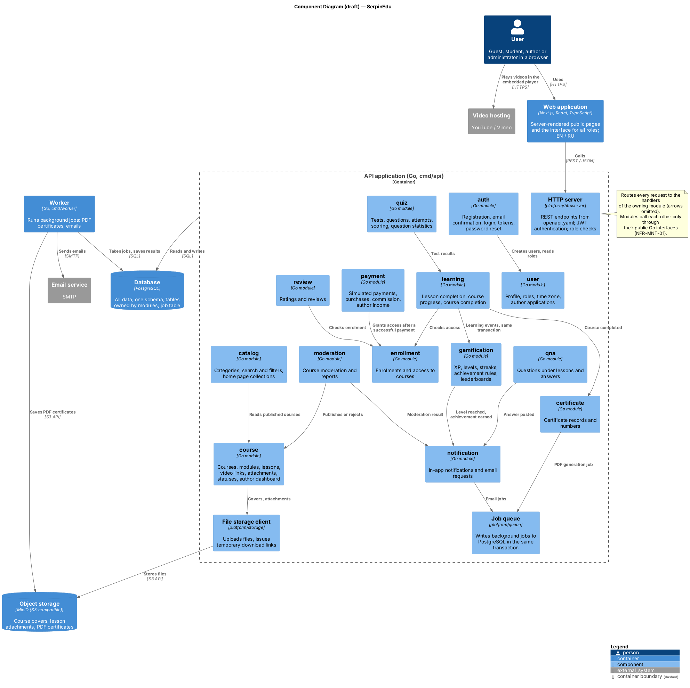

# Architecture Description

**Project:** SerpinEdu — Development of a Management System of Educational Electronic Courses
**Task:** DIP-9 (diagrams: DIP-8)
**Status:** Version 1 (pre-defense 1). The component level is a draft and may change during implementation.

## 1. Purpose and scope

This document describes the architecture of SerpinEdu version 1: its context, users and use cases, deployable parts, backend modules, data, key scenarios and architecture decisions. It links every element to the [functional requirements](../06-requirements/functional-requirements.md) and [non-functional requirements](../06-requirements/non-functional-requirements.md), so that requirements, components, data and scenarios can be checked against each other.

| Diagram | Notation | Source | Image |
|---|---|---|---|
| System context | C4, level 1 | [`system-context.puml`](../../diagrams/src/system-context.puml) | [`system-context.png`](../../diagrams/exports/system-context.png) |
| Use cases | UML use case diagram | [`use-case.puml`](../../diagrams/src/use-case.puml) | [`use-case.png`](../../diagrams/exports/use-case.png) |
| Components (draft) | C4, level 3 | [`component.puml`](../../diagrams/src/component.puml) | [`component.png`](../../diagrams/exports/component.png) |

All diagrams are written in PlantUML. The PNG files are generated from the sources and must be regenerated after every change of a source file.

## 2. Architectural drivers

### 2.1 Functional drivers

The drivers come from the [technology comparison](../05-technology-comparison/technology-comparison.md), section 2:

| ID | Driver |
|---|---|
| D1 | One learning action updates progress, XP, level, streak, achievements and notifications |
| D2 | Relational domain that must stay consistent (users, courses, tests, enrolments, payments, certificates) |
| D3 | Achievement conditions are stored as data and can be added without code changes |
| D4 | Weekly and all-time leaderboards with the student's own position |
| D5 | Streaks counted by the student's local date |
| D6 | Public catalog and course pages; English and Russian interface |
| D7 | Team of two students and a fixed academic timeline |

### 2.2 Quality requirements with the strongest effect on the architecture

| Requirement | Effect on the architecture |
|---|---|
| NFR-PERF-02 (learning event ≤ 1 s, p95) | Gamification is processed synchronously inside the request, without remote calls |
| NFR-PERF-03 (leaderboard ≤ 500 ms, p95), NFR-CAP-01 (500,000 XP records) | Leaderboards are SQL queries with window functions over indexed XP records (section 8.3) |
| NFR-REL-01 (atomic learning event), NFR-REL-02 (no double XP) | One database transaction per learning event; a unique key per XP source |
| NFR-REL-03 (UTC timestamps) | All timestamps in UTC; conversion to the student's or the platform's time zone in the gamification module |
| NFR-REL-04 (failed payment never grants access) | Purchase and enrolment are written in one transaction |
| NFR-SEC-02, NFR-SEC-03 (tokens, role checks) | JWT authentication and role checks in the HTTP server for every endpoint |
| NFR-MNT-01 (modules with public interfaces) | Modular monolith; modules call each other only through Go interfaces |
| NFR-MNT-04 (configurable XP, levels, achievements) | XP values, level thresholds and achievement rules are stored in the database |
| NFR-POR-02 (local start with one command) | All containers are started together with Docker Compose |

### 2.3 Constraints

- Selected stack (technology comparison, section 9): Go, PostgreSQL, REST with OpenAPI, React with Next.js, modular monolith.
- Payments work only in test mode: they are simulated inside the system, and no external payment provider is used (FR-PAY-01).
- Lesson videos are hosted on YouTube or Vimeo ([ADR-0004](adr/0004-lesson-videos-on-youtube-or-vimeo.md)).

## 3. System context

| Element | Type | Role |
|---|---|---|
| Guest | Person | Browses the catalog and course pages, opens preview lessons, registers |
| Student | Person | Enrols in courses, pays in test mode, studies, takes tests, earns XP, levels, streaks and achievements |
| Author | Person | A student with the author role: creates courses and tests, answers questions, sees statistics and income |
| Administrator | Person | Moderates courses, author applications and reports; manages categories, achievements and settings |
| Email service | External system | SMTP server that delivers emails (FR-NOT-02); Mailpit is used in local development |
| Video hosting | External system | YouTube or Vimeo; hosts lesson videos and provides the embedded player (FR-LRN-04) |

## 4. Use cases

An author is a student with additional rights, and a student can do everything a guest can; this is shown by actor generalisation. "UC11 Update gamification progress" is included in studying a lesson and taking a test: it is the event chain of driver D1.

| ID | Use case | Actor | Functional requirements |
|---|---|---|---|
| UC01 | Browse and search the catalog | Guest | FR-CAT-01, FR-CAT-02, FR-CAT-03, FR-CAT-04 |
| UC02 | View a course page | Guest | FR-CAT-05 |
| UC03 | Watch a preview lesson | Guest | FR-CAT-06 |
| UC04 | Register and confirm email | Guest | FR-ACC-01, FR-ACC-02 |
| UC05 | Log in and reset password | Guest | FR-ACC-03, FR-ACC-04 |
| UC06 | Edit profile | Student | FR-ACC-06 |
| UC07 | Enrol in a course | Student | FR-LRN-01, FR-LRN-02 |
| UC08 | Pay for a course (test mode) | Student | FR-PAY-01, FR-PAY-02 |
| UC09 | Study a lesson | Student | FR-LRN-03, FR-LRN-04, FR-LRN-05, FR-LRN-07 |
| UC10 | Take a test | Student | FR-LRN-06 |
| UC11 | Update gamification progress | (included) | FR-GAM-01, FR-GAM-02, FR-GAM-03, FR-GAM-04, FR-GAM-06, FR-GAM-07, FR-GAM-08 |
| UC12 | Get a certificate | Student | FR-LRN-08, FR-LRN-09 |
| UC13 | Ask a question under a lesson | Student | FR-LRN-10 |
| UC14 | Rate and review a course | Student | FR-LRN-11 |
| UC15 | Report content | Student | FR-LRN-13 |
| UC16 | View my courses and purchases | Student | FR-LRN-12, FR-PAY-03 |
| UC17 | View profile, level, streak and achievements | Student | FR-ACC-07, FR-GAM-05, FR-GAM-09, FR-GAM-13 |
| UC18 | View leaderboards | Student | FR-GAM-10, FR-GAM-11, FR-GAM-12 |
| UC19 | View notifications | Student | FR-NOT-01 |
| UC20 | Apply to become an author | Student | FR-AUT-01 |
| UC21 | Create and edit a course | Author | FR-AUT-02, FR-AUT-03, FR-AUT-04, FR-AUT-06 |
| UC22 | Create a test | Author | FR-AUT-05 |
| UC23 | Submit a course for moderation | Author | FR-AUT-07 |
| UC24 | View author dashboard | Author | FR-AUT-08, FR-AUT-09, FR-AUT-10, FR-PAY-04 |
| UC25 | Answer student questions | Author | FR-AUT-11 |
| UC26 | Moderate courses | Administrator | FR-ADM-01 |
| UC27 | Review author applications | Administrator | FR-ADM-02 |
| UC28 | Resolve reports | Administrator | FR-ADM-03 |
| UC29 | Manage categories | Administrator | FR-ADM-04 |
| UC30 | Configure platform settings | Administrator | FR-ADM-05 |
| UC31 | Manage achievements | Administrator | FR-ADM-06 |

Emails (FR-NOT-02) are sent in UC04, UC05, UC08 and UC26. Three requirements apply to all use cases and are not separate use cases: FR-ACC-05 (roles), FR-UI-01 (English and Russian interface) and FR-UI-02 (mobile layout).

## 5. Containers

| Container | Technology | Responsibility | Talks to |
|---|---|---|---|
| Web application | Next.js, React, TypeScript | Server-rendered public pages (catalog, course pages) and the interface for all roles; EN / RU translation files (NFR-USE-01) | API application (REST / JSON); embeds the YouTube / Vimeo player |
| API application | Go (`backend/cmd/api`) | All business logic, organised in modules (section 6); REST API described in `backend/api/openapi.yaml` (NFR-MNT-02) | PostgreSQL, object storage |
| Worker | Go (`backend/cmd/worker`) | Background jobs: PDF certificates and emails ([ADR-0006](adr/0006-background-jobs-in-postgresql.md)) | PostgreSQL, object storage, email service |
| Database | PostgreSQL | All application data and the job table | — |
| Object storage | MinIO (S3-compatible) | Course covers, lesson attachments, PDF certificates ([ADR-0005](adr/0005-object-storage-for-files.md)) | — |

The API application and the worker share the Go code in `backend/internal/`; they are two programs built from one code base. All containers are started locally with Docker Compose (NFR-POR-02).

## 6. Components of the API application

Each module lives in its own folder in `backend/internal/` and owns its tables. Other modules use it only through its public Go interface (NFR-MNT-01).

| Module | Responsibility | Functional requirements | Main data (tables) |
|---|---|---|---|
| auth | Registration, email confirmation, login and logout, tokens, password reset | FR-ACC-01, FR-ACC-02, FR-ACC-03, FR-ACC-04, FR-ACC-05 | refresh tokens, email tokens |
| user | Profile, roles, interface language, time zone, author applications | FR-ACC-06, FR-ACC-07, FR-AUT-01, FR-ADM-02, FR-UI-01 | users, author applications |
| catalog | Categories, search and filters, home page collections | FR-CAT-01, FR-CAT-02, FR-CAT-03, FR-CAT-04, FR-ADM-04 | categories |
| course | Courses, modules, lessons (video link, text, test), attachments, preview lesson, course status; composes the author dashboard | FR-CAT-05, FR-CAT-06, FR-AUT-02, FR-AUT-03, FR-AUT-04, FR-AUT-06, FR-AUT-07, FR-AUT-08 | courses, course modules, lessons, attachments |
| quiz | Tests, questions, attempts, scoring, per-question statistics | FR-AUT-05, FR-LRN-06, FR-AUT-09 (question statistics) | tests, questions, answer options, attempts, attempt answers |
| enrollment | Enrolments and access to courses | FR-LRN-01, FR-LRN-02, FR-LRN-12 | enrolments |
| learning | Opening lessons, lesson completion, course progress and completion | FR-LRN-03, FR-LRN-04, FR-LRN-05, FR-LRN-07, FR-LRN-08, FR-AUT-09 (student progress) | lesson completions, course completions |
| payment | Simulated payments, purchases, commission, author income | FR-PAY-01, FR-PAY-02, FR-PAY-03, FR-PAY-04, FR-AUT-10, FR-ADM-05 (commission) | purchases, commission rates |
| gamification | XP, levels, streaks, achievements, leaderboards; submodules `xp`, `level`, `streak`, `achievement`, `leaderboard` | FR-GAM-01 – FR-GAM-13, FR-ADM-05 (leaderboard time zone), FR-ADM-06 | XP awards, student statistics, level thresholds, achievements, student achievements, gamification settings |
| certificate | Certificate records, unique numbers, PDF generation job | FR-LRN-09 | certificates |
| review | Ratings and reviews, average rating | FR-LRN-11 | reviews |
| qna | Questions under lessons and answers | FR-LRN-10, FR-AUT-11 | questions, answers |
| moderation | Course moderation decisions, reports | FR-ADM-01, FR-ADM-03, FR-LRN-13 | moderation decisions, reports |
| notification | In-app notifications, email requests | FR-NOT-01, FR-NOT-02 | notifications |

Technical components in `backend/internal/platform/`:

| Component | Responsibility |
|---|---|
| `httpserver` | Routing, JSON, JWT authentication, role checks (NFR-SEC-03), rate limits for login and password reset (NFR-SEC-05) |
| `database` | Connection pool, transactions, migrations from `backend/migrations/` |
| `queue` | Writes jobs to the job table in the caller's transaction; the worker reads them |
| `storage` | Uploads files to the object storage and issues temporary download links |
| `mailer` | Sends emails over SMTP (used by the worker) |
| `config` | Reads settings from environment variables (NFR-SEC-06) |

The interface requirements FR-UI-01 (English and Russian) and FR-UI-02 (mobile layout) are implemented in the web application: translation files and a responsive layout. The backend only stores the user's interface language.

The author dashboard (FR-AUT-08 – FR-AUT-10) combines data from several modules. The `course` module builds it by calling the public interfaces of `enrollment`, `learning`, `quiz` and `payment`.

## 7. Data

The detailed data model (ER diagram) will be produced together with the first database migrations. Version 1 follows these rules:

- **One database, owned tables.** All data is in one PostgreSQL database. Each table belongs to one module (section 6). A module never writes to another module's tables; it reads other modules' data through their interfaces. Read-only database views may be used where performance requires it (catalog search, leaderboards).
- **Time.** All timestamps are stored in UTC (NFR-REL-03). Each user has a time zone (FR-ACC-06), and the platform has a time zone for the weekly leaderboard (FR-ADM-05).
- **XP awards.** Every award is a row with the student, the source (lesson, test or course), the XP value and the time (FR-GAM-02). A unique key on student and source prevents double awards (NFR-REL-02). Total XP, level and streaks are kept in a per-student statistics row that is updated in the same transaction.
- **Configurable gamification.** XP values, level thresholds and achievement rules are rows in the database, not constants in code (NFR-MNT-04). Achievement conditions are stored as `jsonb` (D3).
- **Money.** Prices and amounts are stored in cents with the currency `USD`. Each purchase stores the commission percentage that was valid at the time of purchase (FR-PAY-04).
- **Files.** The database stores only the object key of a file; the file itself is in the object storage. A video lesson stores only the YouTube or Vimeo link.

## 8. Key scenarios

### 8.1 Completing a lesson (driver D1)

Requirements: FR-LRN-05, FR-LRN-07, FR-LRN-08, FR-GAM-01 – FR-GAM-08, NFR-PERF-02, NFR-REL-01, NFR-REL-02.

1. The web application sends `POST /api/v1/lessons/{id}/complete`.
2. The HTTP server checks the token and the student role.
3. `learning` checks access through `enrollment` and opens a database transaction.
4. `learning` records the lesson completion and recalculates course progress.
5. `learning` passes the event to `gamification`, which:
   - adds the XP award (or skips it if this source was already awarded),
   - updates total XP and level,
   - updates the streak using the student's local date,
   - evaluates the achievement rules for this event.
6. If this was the last lesson or test, `learning` records the course completion. `gamification` adds the course XP, and `certificate` creates the certificate record and writes a PDF job to the job table.
7. `notification` creates in-app notifications (new level, achievement, certificate).
8. The transaction is committed. The response returns the new progress and gamification values ([API examples](../08-prototype/api-examples.md), example 5).
9. The worker takes the PDF job, generates the certificate, saves it in the object storage and marks it as ready (NFR-PERF-04).

Submitting a test attempt follows the same path: `quiz` scores the attempt and passes the result to `learning`.

### 8.2 Buying a course in test mode

Requirements: FR-PAY-01, FR-PAY-02, FR-PAY-04, FR-LRN-02, FR-NOT-02, NFR-REL-04.

1. The student chooses the simulated result (success or failure) on the checkout page.
2. `payment` records the purchase with the price, the current commission percentage and the status.
3. On success, `enrollment` creates the enrolment in the same transaction, and `notification` writes a purchase email job.
4. On failure, the purchase is stored with the status "failed" and no enrolment is created.

### 8.3 Weekly leaderboard

Requirements: FR-GAM-10, FR-GAM-12, NFR-PERF-03, NFR-CAP-01.

1. `gamification` calculates the start of the current week: Monday 00:00 in the platform time zone, converted to UTC.
2. One SQL query sums XP awards since that moment per student and ranks them with the `RANK()` window function, so equal XP gives an equal rank (1, 2, 2, 4).
3. The response contains the top 50 and the requesting student's own row.

The XP awards table is indexed by award time. If performance tests show that this query does not meet NFR-PERF-03 with 500,000 XP records, a weekly aggregate table updated in scenario 8.1 will be added.

### 8.4 Course moderation

Requirements: FR-AUT-07, FR-ADM-01, FR-NOT-01, FR-NOT-02.

1. The author submits a course; `course` changes its status from Draft to Pending review.
2. The administrator approves or rejects it with a comment; `moderation` records the decision and asks `course` to change the status to Published or Rejected.
3. `notification` creates an in-app notification and an email job for the author.

### 8.5 Watching a video lesson

Requirements: FR-CAT-06, FR-LRN-03, FR-LRN-04.

1. The web application requests the lesson. `learning` returns the video link only to an enrolled student, the course author or an administrator; the preview lesson is open to everyone.
2. The browser shows the YouTube or Vimeo player embedded in the lesson page.
3. The student marks the lesson as completed (scenario 8.1); XP does not depend on watching time.

## 9. Cross-cutting concerns

| Concern | Approach | Requirements |
|---|---|---|
| Authentication | Access token (JWT) for 15 minutes and refresh token for 30 days; passwords hashed with bcrypt or Argon2 | NFR-SEC-01, NFR-SEC-02 |
| Authorisation | Role check for every endpoint in the HTTP server: 401 without a token, 403 with an insufficient role | FR-ACC-05, NFR-SEC-03 |
| Input and output | Parameterised SQL; user text escaped when displayed | NFR-SEC-04 |
| Configuration and secrets | Environment variables; `.env.example` contains only placeholders | NFR-SEC-06 |
| Time zones | UTC in the database; student time zone for streaks; platform time zone for the weekly leaderboard | NFR-REL-03, FR-GAM-04, FR-GAM-10 |
| Languages | Interface texts in translation files for English and Russian; language stored in the profile | FR-UI-01, NFR-USE-01 |
| Notifications | The web application requests the unread counter when a page opens and then every 60 seconds (configurable) ([ADR-0007](adr/0007-notification-polling.md)) | FR-NOT-01 |
| Files | Uploaded through the API; attachments and certificates are downloaded through temporary links after an access check | FR-AUT-02, FR-LRN-09 |
| API contract | Every endpoint is described in `backend/api/openapi.yaml` | NFR-MNT-02 |

## 10. Architecture decisions

Decisions are recorded as architecture decision records (ADRs) in [`adr/`](adr/).

| ADR | Decision | Status |
|---|---|---|
| [0001](adr/0001-record-architecture-decisions.md) | Record architecture decisions as ADRs | Accepted |
| [0002](adr/0002-modular-monolith.md) | Modular monolith with Go, PostgreSQL, REST and Next.js | Accepted |
| [0003](adr/0003-synchronous-learning-events.md) | Process learning events synchronously in one transaction | Accepted |
| [0004](adr/0004-lesson-videos-on-youtube-or-vimeo.md) | Host lesson videos on YouTube or Vimeo | Accepted |
| [0005](adr/0005-object-storage-for-files.md) | Store files in S3-compatible object storage (MinIO) | Accepted |
| [0006](adr/0006-background-jobs-in-postgresql.md) | Run background jobs from a PostgreSQL job table in a worker | Accepted |
| [0007](adr/0007-notification-polling.md) | Update the notification counter by polling | Accepted |

## 11. Consistency with other documents

| Document | Change made for this architecture |
|---|---|
| Functional requirements | FR-AUT-04 and FR-LRN-04 state that video lessons use a YouTube or Vimeo link and the embedded player (ADR-0004) |
| `.env.example` | Removed `REDIS_*` (no Redis, ADR-0006) and `STRIPE_*` (payments are simulated, FR-PAY-01); `S3_*` kept for MinIO (ADR-0005) |
| Risks (`docs/10-project-management/risks-and-dependencies.md`) | R11 "Video delivery approach not yet decided" is resolved by ADR-0004; the risk of shared video links (section 12) is to be added |

## 12. Risks and limitations

| Risk or limitation | Consequence | Response |
|---|---|---|
| A video link of a paid course can be shared outside the platform | Videos can be watched without buying the course | Accepted for version 1. The API gives the link only to users with access (scenario 8.5); recorded in ADR-0004 |
| The author removes or hides a video on YouTube or Vimeo | The lesson cannot be played | Moderators check the links during review; students can report the course (FR-LRN-13) |
| One database for all modules | A database failure stops the whole system | Acceptable at the scale of the project (NFR-CAP-01); regular backups |
| Notifications arrive with a delay of up to 60 seconds | The counter is not real-time | Acceptable for FR-NOT-01 (ADR-0007) |
| Leaderboard performance is not yet measured | NFR-PERF-03 may not be met | Performance test in the verification plan; aggregate table as a fallback (section 8.3) |
| The component diagram is a draft | Module boundaries may change | Changes are recorded in new ADRs and in this document |

## 13. Open questions

- How the web application keeps the tokens in the browser.
- Which library generates the PDF certificates.
- Where the system is deployed for the demonstration, and which SMTP provider is used there.
