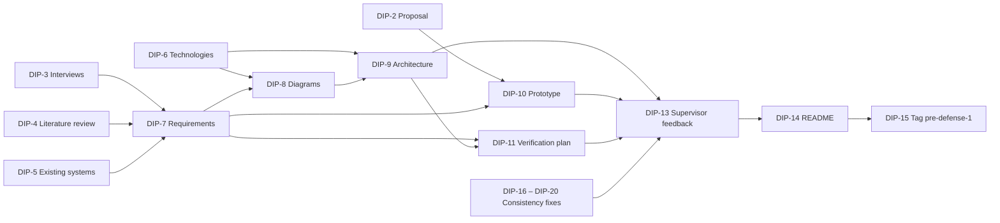

# Risks and Dependencies

## 1. Risks

**Scale:** Likelihood and Impact are rated **Low / Medium / High**. The risk list is reviewed at each pre-defense and updated when new risks appear.

### Project risks

| ID | Risk | Likelihood | Impact | Mitigation | Owner |
|---|---|---|---|---|---|
| R1 | **Limited team capacity.** Two people for a broad scope (marketplace, learning, administration, gamification) | High | High | Prioritise requirements (must / should / could); implement must-have features first; optional items (e.g. mobile layout) are dropped first; review scope at each pre-defense | Both |
| R2 | **Fixed academic deadlines; dates of later pre-defenses not yet known** | Medium | High | Work in small tasks; keep `main` in a presentable state at all times; tag each submission | Both |
| R3 | **Difficulty finding interview participants** — *closed: 5 interviews conducted (DIP-3)* | Medium | Medium | Invite students and online course users from the team's network; allow remote calls; minimum of 3 interviews | Both |
| R4 | **Late or unavailable supervisor feedback before a deadline** | Medium | Medium | Send drafts early (at least two days before a pre-defense); record feedback and decisions in `docs/11-supervisor-feedback/` | Both |
| R5 | **Requirement changes after supervisor or committee feedback** | Medium | Medium | Keep requirements under version control; every change goes through a YouTrack task and a pull request | Both |

### Technical risks

| ID | Risk | Likelihood | Impact | Mitigation | Owner |
|---|---|---|---|---|---|
| R6 | **Complexity of the gamification event chain.** One learning event must consistently update progress, XP, level, streak, achievements and notifications | Medium | High | Design the event chain in the architecture first; process related updates in one database transaction; cover XP and achievement rules with automated tests | Adil Ramazan |
| R7 | **Time zone edge cases in daily streaks** (activity near midnight, students changing their time zone) | Medium | Medium | Store the time zone per student; calculate local dates on the backend; add test cases for boundary situations | Adil Ramazan |
| R8 | **Gaming the system and negative effects of competition.** The literature links leaderboards and badges to cheating and demotivation (see literature review, S7, S9) | Medium | Medium | Award XP only once per activity; weekly leaderboard reset; always show the student's own position | Adil Ramazan |
| R9 | **Integration problems between frontend and backend developed in parallel** | Medium | Medium | Agree on the API contract in the OpenAPI specification before implementation; automated API tests | Yerassyl Kuanyshov |
| R10 | **Unfamiliar parts of the selected stack** (e.g. Next.js server rendering, PostgreSQL window functions) | Medium | Medium | Build small technical prototypes early; review each other's code | Both |
| R11 | **Video delivery approach not yet decided** (storage, size limits, playback) — *closed: decided in ADR-0004 (YouTube or Vimeo links) and ADR-0005 (object storage for other files)* | Medium | Medium | Decide during architecture design (DIP-9); choose the simplest option that meets the requirements | Adil Ramazan |
| R15 | **Lesson videos can be watched outside the platform.** A YouTube or Vimeo link of a paid course can be shared, and an author can remove or hide a video | Medium | Medium | The API returns the link only to users with access (ADR-0004); moderators check the links during review; students can report broken lessons (FR-LRN-13); accepted limitation of version 1 | Yerassyl Kuanyshov |
| R16 | **Deployment environment for the user study not yet chosen** (server, domain, SMTP provider) | Medium | Medium | Choose it before pre-defense 2; the system runs with Docker Compose on any virtual machine (NFR-POR-02) | Both |
| R12 | **Security of user data** (passwords, tokens, personal data from interviews) | Low | High | No secrets in the repository (`.gitignore`, `.env.example` with placeholders); hashed passwords; anonymised interview notes | Both |
| R13 | **Loss of work** | Low | High | All work is pushed to GitHub; `main` is protected and changed only through reviewed pull requests | Both |

### Research risk

| ID | Risk | Likelihood | Impact | Mitigation | Owner |
|---|---|---|---|---|---|
| R14 | **Gamification may not increase engagement as expected.** The literature shows mixed results and a novelty effect (see literature review, sections 4–5) | Medium | Medium | Treat the effect as a hypothesis; evaluate it according to the verification and evaluation plan; report results honestly, including negative ones | Both |
| R17 | **Not enough participants for the user study, or dropout during its four weeks** | Medium | High | Recruit at least 2 more participants than the minimum of 10; agree on participation in advance; report dropout as a result (verification and evaluation plan, section 4.9) | Both |

## 2. Dependencies

### 2.1 Task dependencies (pre-defense 1)

| Task | Depends on | Reason |
|---|---|---|
| DIP-7 Requirements | DIP-3, DIP-4, DIP-5 | Requirements must be based on evidence from interviews, literature and the comparison of existing systems |
| DIP-8 Diagrams | DIP-6, DIP-7 | Use case diagram follows the requirements; component diagram follows the selected technologies |
| DIP-9 Architecture description | DIP-6, DIP-8 | Describes the diagrams and the selected technologies |
| DIP-10 Prototype | DIP-2, DIP-7 | Screens are based on the scope in the proposal; the traceability table uses the requirement IDs |
| DIP-11 Verification plan | DIP-7, DIP-9 | Tests verify the acceptance criteria of the requirements; end-to-end scenarios use the use cases of the architecture |
| DIP-16 – DIP-20 Consistency fixes | DIP-2 – DIP-12 | Earlier documents are aligned with later results (interviews, requirements, architecture, verification plan) |
| DIP-13 Supervisor feedback | DIP-2 – DIP-12, DIP-16 – DIP-20 | The supervisor reviews the prepared deliverables |
| DIP-14 README | DIP-2 – DIP-13 | The README links to all deliverables |
| DIP-15 Pre-defense tag | All tasks | The tag marks the final submitted version |

These dependencies are also recorded in YouTrack as "depends on" links between tasks.

### 2.2 Planned implementation dependencies

| Component | Depends on |
|---|---|
| Backend modules | Database schema; authentication and authorization (roles) |
| Frontend pages | API contract (OpenAPI specification) |
| Gamification (XP, levels, streaks, achievements, leaderboards) | Learning module events (lesson completed, test passed, course completed) |
| Certificates | Course progress and test results |

### 2.3 External dependencies

| Dependency | Affects | Mitigation |
|---|---|---|
| Supervisor availability for reviews | DIP-13, every pre-defense | Agree on review dates in advance (R4) |
| Interview participants | DIP-3, DIP-7 | Invite more people than the minimum (R3) |
| Video hosting (YouTube, Vimeo) | Video lessons (FR-LRN-04) | Links are checked during moderation (R15) |
| SMTP provider and hosting for the user study | Emails (FR-NOT-02), user study | Chosen together with the deployment environment (R16) |
| Participants of the user study | Evaluation (verification and evaluation plan, section 4) | Recruit more people than the minimum (R17) |
| University schedule (pre-defense dates) | Milestones M2–M4 | Update milestones when dates are announced (R2) |
| GitHub and YouTrack availability | All work | Work is also kept in local clones of the repository |
